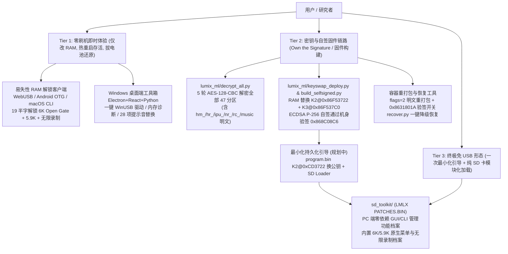

# LUMIX DC-S5 技术架构总览

> [!CAUTION]
> 本文档仅作嵌入式系统与固件安全技术研究记录，不构成任何商业或官方技术支持。请先阅读 **[DISCLAIMER.md](DISCLAIMER.md)**。

本文档说明 DC-S5（`MC801` / `pvc03v`, FW 2.9）仓库中**易失性 RAM 解锁模块**、**Windows 桌面端驱动/音效工具箱**与**密钥自签及 SD 卡模块化基座**三层技术架构的协同关系与安全边界。

---

## 一、分层架构全景

---

## 二、三条技术路线对照

| 维度 | 密钥自签与 SD 卡基座路线 | 易失性 RAM 视频解锁路线 | 桌面端音效与容器分析路线 |
|---|---|---|---|
| **核心能力** | **AES 5 轮全分区解密** + **ECDSA 换公钥自签（Own the Signature）** + 启动链钩取 + SD 卡模块化 `LMLX` 协议 | **真机已验证**的 6K Open Gate / 5.9K 原生菜单与全模式无限录制；跨平台 WebUSB / Android OTG / macOS | **Windows 桌面 GUI**、一键 WinUSB 驱动安装、RAM 暂存区可视化诊断、28 项音效替换与 `flags=2` 明文重打包工具 |
| **固件解密** | AES-128-CBC 5 轮密钥 `194364775255595d04e48de2b15e5c2c`，**47 分区全明文** | 仅需运行态 RAM 读写，不依赖解密 | 从 RAM 提取 `program` / `postboot` / `rootfs`，配合 AES 全解密补齐其余分区 |
| **验签机制** | **换公钥自签**：替换 `K2@0x86F53722` + `K3@0x86F537C0` 为本地 P-256 公钥，机身 `0x868C08C6` 正常验签通过，**保留签名保护** | 不改 Flash，仅写 19 个 RAM 半字 + 13 锚点校验 | **验签开关**：`0x8631801A` 写 `1` 跳过更新验签 + 容器记录 `flags=2` 明文打包 |
| **持久化边界** | RAM 换公钥已验证；持久化换公钥（改 `program.bin` 偏移 `0xCD3722` + 重加密 + 自签）规划就绪 | 电源键热重启（Suspend-to-RAM）持久化，拔电池还原 | 音效为 RAM 暂存区热重启持久化；`recover.py` 提供版本降级恢复支持 |

---

## 三、密钥与自签固件链路（Own the Signature）

相较于直接关闭验签（`0x8631801A = 1`），**换公钥（Own the Signature）** 在持久化阶段具备显著安全性优势：相机依然执行完整的 ECDSA P-256 验签与外层 CRC32 校验，只是信任锚从原厂公钥切换为本地生成的公钥，防止误刷损坏或未签名包。

### 1. 固件容器正确打包顺序（已实机验证，顺序不可颠倒）
1. **修改版本号**：写入 `0x1C`（外层头）与 `0x2BC`（签名摘要覆盖区内），例如 `0x02A002A0`（高于机身当前 V2.90）。
2. **重算摘要**：`digest = SHA256(fw[0x2A0:0x142C])`，按小端整数解释为 `e`。
3. **ECDSA P-256 自签**：使用本地私钥对 `e` 签名，将 `r || s`（各 32 字节小端）写入 `0x220:0x260`。
4. **重算外层 CRC32**：`zlib.crc32(fw[0x200:]) & 0xFFFFFFFF` 写入 `0x40`。

对应便携实现：`lumix_ml/build_selfsigned.py` 与 `lumix_ml/keyswap_deploy.py`（纯 Python 标准库，依赖同目录 `lumix_ml/ecdsa_recover.py`，无第三方包）。

### 2. 从 RAM 换公钥到 SD 卡模块化基座的演进路径
1. **阶段 0（安全基线）**：确认可正常通过官方 `S5___V29.bin`（或配合 `recover.py` 版本降级）完成安全回滚。
2. **阶段 1（RAM 级闭环，已完成）**：在纯 RAM 中完成 6K/5.9K/无限录制解锁与换公钥自签验证。
3. **阶段 2（RAM 级 SD Loader 联调）**：
   - 利用 `sd_toolkit` 生成 `SD:\LUMIX_ML\PATCHES.BIN`（已内置 19 半字实测档案）。
   - 在主核 SD 挂载完成切入点（首选 `0x06470124` 之后，调用主核 `FS_Open@0x065d36ae` / `FS_Read@0x065d376c` / `FS_Close@0x065d3722`）验证纯 RAM 加载、原厂半字校验与拔卡还原。
4. **阶段 3（唯一一次最小化持久化）**：
   - 在明文 `program.bin` 中替换 `K2` 公钥（偏移 `0xCD3722`）并植入最小化 SD Loader → 5 轮 AES-128-CBC 重加密 → 按正确顺序自签打包 → 刷入机身。
   - 完成后，日常新增/开关 6K、无限录制、码率、菜单等功能只需用 `sd_toolkit` 读写 SD 卡，**彻底脱离 USB 服务模式**。

---

## 四、统一关键地址速查（DC-S5 `MC801` FW 2.9）

| 模块 | Service USB 地址 | 主核 VA | 说明 |
|---|---|---|---|
| **主核代码基址** | `0x86280000` | `0x06280000` | `program.bin` 解压后运行基址（16 MB） |
| **机身版本字段** | `0x863B0000` / `0x863181E2` | `0x063B0000` / `0x063181E2` | `2×u16`，V2.90 = `0x0290` |
| **更新验签函数** | `0x868C08C6` | `0x068C08C6` | 原厂字节 `70b5b0b0`，机身固件 ECDSA 验签 |
| **ECDSA 公钥 K2 / K3** | `0x86F53722` / `0x86F537C0` | `0x06F53722` / `0x06F537C0` | 各 64 字节（`x[::-1] || y[::-1]`），明文偏移 `0xCD3722` |
| **更新验签开关** | `0x8631801A` | `0x0631801A` | `0`=正常验签，`1`=跳过验签 |
| **启动链 Detour / Cave** | `0x800003C4` / `0x8000E300` | — | 复位早期任意 ARM 载荷钩取 |
| **主核任意执行 Cave** | `0x87086300` | `0x07086300` | 跨热重启存活的主核载荷区 |
| **NTSC 白名单尾部** | `0x86F15E90`–`96` | `0x06F15E90`–`96` | 替换 `00D1/00D2` → `00F1/00ED`（5.9K/6K） |
| **Master ROM-in-RAM 模板** | `0x87089614`–`2C` | `0x07089614`–`2C` | 保障电源键热重启后 5.9K/6K 菜单持续存活 |
| **活动/实时 UI 菜单缓冲** | `0x08A68C5C`–`74` / `0x08A6845C`–`74` | 同左 | 实时 `Rec Quality (MOV)` 菜单显示 |
| **录制时长限制 Getter** | `0x868261B6` | `0x068261B6` | `0x4628` → `0x2000` (`movs r0, #0`) 解除 15/30 分钟限制 |
| **音效暂存区** | `0x8F000000` 起 | — | 44.1 kHz 单声道自定义提示音写入区 |
| **SD 文件系统 API** | — | `0x065D36AE` 等 | `FS_Open`/`FS_Read`/`FS_Write`/`FS_Close` |
| **未映射黑洞区（禁读/禁写）** | `>= 0x8C000000` | `>= 0x0C000000` | 访问触发 `err=121` USB 挂起 |
